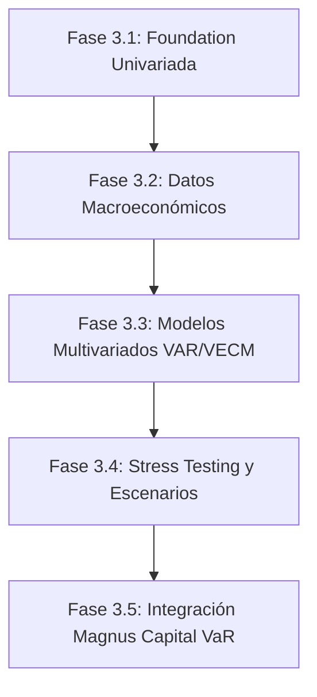

# PROVIDENCE FX — LEVEL 3 ROADMAP
## De la Base Econométrica a la Inteligencia Macroeconómica y Gestión Patrimonial
**Ecosistema:** Providence / Magnus OS2 / Magnus Capital  
**Subsistema:** Providence FX Quantitative Research Engine  
**Fase Actual:** Nivel 3.1 — Foundation (Modelos de Referencia y Laboratorio Estadístico)  
**Horizonte de Implementación:** 2026–2027  
**Principios Rectores:** Rigor matemático, soberanía de datos, cero fuga de información (*zero lookahead*), estabilidad operativa y consumo eficiente de recursos.

---

## 1. VISIÓN ESTRATÉGICA

Providence FX Nivel 3 transforma el subsistema cambiario de Magnus OS2 de un **monitor histórico y agregador de cotizaciones en tiempo real** a una **plataforma institucional de investigación cuantitativa, modelado econométrico y gestión de riesgo patrimonial**.

Los resultados empíricos de la Fase 3.1 demostraron que los modelos univariados (ARIMA, GARCH) capturan con éxito la microestructura y la persistencia de volatilidad en el corto plazo (1 a 5 días), pero confirman el *Enigma de Meese-Rogoff* en horizontes de mediano y largo plazo (20 a 60 días), donde el Random Walk ingenuo no puede ser superado sin la incorporación de **fundamentos macroeconómicos estructurales**.

El presente Roadmap establece la ruta de evolución secuencial estructurada en 5 fases de despliegue controlado.

---

## 2. ETAPAS DEL ROADMAP

---

### ETAPA I: INTEGRACIÓN DE VARIABLES MACROECONÓMICAS (FASE 3.2)
**Objetivo:** Crear el repositorio de series temporales fundamentales de la economía dominicana y global, con estrictas fechas de publicación (*vintage dates*) para evitar cualquier fuga de información retrospectiva.

#### 1. Variables a incorporar
1. **Tasa de Política Monetaria (TPM BCRD) y Fed Funds Rate (EE.UU.):**
   - Construcción del diferencial de tasas de interés nominal: $\Delta i_t = i_{\text{DOP}, t} - i_{\text{USD}, t}$.
   - Evaluación de la Paridad Descubierta de Tasas de Interés (UIP).
2. **Índice de Precios al Consumidor (IPC) e Inflación:**
   - IPC República Dominicana (mensual BCRD) e IPC EE.UU. (mensual BLS).
   - Cálculo del diferencial inflacionario acumulado y Paridad de Poder Adquisitivo (PPP).
3. **Reservas Internacionales Netas (RIN BCRD):**
   - Nivel de RIN en millones de USD y cobertura en meses de importaciones.
   - Variaciones mensuales de reservas como *proxy* de intervención cambiaria oficial.
4. **Factura Petrolera y Términos de Intercambio:**
   - Cotización diaria del West Texas Intermediate (WTI / CL=F) desde Yahoo Finance / FRED.
   - República Dominicana es un importador neto de hidrocarburos; los shocks del crudo impactan directamente la demanda neta de divisas.
5. **Flujos Externos de Divisas:**
   - Remesas familiares mensuales (BCRD).
   - Ingresos por turismo y llegada de pasajeros no residentes (BCRD / MITUR).

#### 2. Arquitectura de Ingesta y Prevención de Fuga (Vintage Data Engine)
- **Regla Inquebrantable:** Cada variable macroeconómica se almacena con dos marcas temporales:
  1. `reference_period` (ej. `2026-08-01` para los datos de agosto).
  2. `release_timestamp` (ej. `2026-09-15 14:00:00` cuando el BCRD publicó la nota de prensa).
- En backtesting, ningún modelo puede acceder a una cifra macroeconómica si la fecha simulada es anterior al `release_timestamp`.

---

### ETAPA II: MODELOS MULTIVARIABLES Y COINTEGRACIÓN (FASE 3.3)
**Objetivo:** Superar el benchmark Random Walk en horizontes de mediano plazo (20 a 60 días) mediante la captura de relaciones de equilibrio de largo plazo.

#### 1. ARIMAX con Regresores Exógenos
- Modelos de corto/mediano plazo que incorporan el diferencial de tasas $\Delta i_{t-k}$ y la variación del crudo WTI $\Delta \text{Oil}_{t-k}$ como variables exógenas:
  $$\Delta P_t = c + \sum_{p=1}^P \phi_p \Delta P_{t-p} + \sum_{j=1}^m \beta_j X_{j, t-1} + \epsilon_t$$

#### 2. Vectores Autorregresivos (VAR) y Modelos VECM
- **Prueba de Cointegración de Johansen:** Evaluar si el vector $[\ln(P_{\text{USD/DOP}}), \ln(\text{IPC}_{\text{DOM}}), \ln(\text{IPC}_{\text{USA}}), \Delta i]$ comparte una tendencia estocástica común.
- Si existe cointegración, se implementará un **Vector Error Correction Model (VECM)**:
  $$\Delta Y_t = \Pi Y_{t-1} + \sum_{i=1}^{k-1} \Gamma_i \Delta Y_{t-i} + u_t$$
  donde $\Pi = \alpha \beta'$ define la velocidad de ajuste ($\alpha$) hacia la paridad de poder adquisitivo de largo plazo ($\beta$).

---

### ETAPA III: ANÁLISIS DE ESCENARIOS Y STRESS TESTING (FASE 3.4)
**Objetivo:** Evaluar la resiliencia patrimonial corporativa ante choques geopolíticos, monetarios y climáticos extremos.

#### 1. Definición de Escenarios de Estrés
1. **Escenario "Fed Tightening Shock":**
   - La Reserva Federal eleva su tasa en $+100 \text{ bps}$ imprevistamente, mientras el BCRD mantiene su TPM fija.
   - Ampliación del diferencial negativo de rendimiento de carry trade.
2. **Escenario "Oil Price Surge":**
   - El barril WTI se incrementa a $\$105 \text{ USD}$, elevando la factura de importación de combustibles en un 35%.
   - Presión sobre la cuenta corriente y mayor demanda de dólares en el mercado spot.
3. **Escenario "Tourism Inflow Drop":**
   - Caída del 20% en ingresos por turismo durante la temporada alta invernal por recesión en economías emisoras.
4. **Escenario "Eventos Extremos Tipo 2003":**
   - Simulación de estrés no lineal basada en la distribución de colas pesadas de la crisis bancaria dominicana de 2003–2004 identificada en la Fase 3.1.

#### 2. Generador de Densidades y Simulaciones Monte Carlo
- Empleo de cópulas estadísticas y simulación bootstrap con innovación de colas pesadas (Student-t) condicionada a los parámetros GARCH(1,1) estimados.

---

### ETAPA IV: GESTIÓN DE RIESGO PATRIMONIAL Y MAGNUS CAPITAL (FASE 3.5)
**Objetivo:** Conectar el Quantitative Research Engine directamente con los libros contables y tesorería corporativa de Magnus Capital.

#### 1. Métricas de Riesgo en Tiempo Real
- **Value at Risk (VaR):**
  - Estimación paramétrica y Cornish-Fisher al 95% y 99% para carteras denominadas en DOP y USD.
  - Horizontes de liquidación: 1 día, 10 días y 30 días.
- **Expected Shortfall (CVaR):**
  - Pérdida esperada condicional a que el shock exceda el umbral de corte del VaR.
- **Margen de Reserva Cambiaria Recomendado:**
  - Cálculo del colchón óptimo de liquidez en dólares para empresas importadoras, minimizando costos de financiamiento en DOP vs riesgo de devaluación abrupta.

#### 2. Motor de Recomendación de Cobertura (Synthetic Forward Hedging)
- Ante una probabilidad superior al 65% de depreciación acelerada en un horizonte de 30 días, el sistema genera alertas de cobertura preventiva para la mesa de dinero de Magnus Capital.

---

### ETAPA V: ALERTAS INTELIGENTES, GOBERNANZA Y SOBERANÍA TÉCNICA

#### 1. Índice de Presión en el Mercado Cambiario (EMPI)
- Creación del **Dominican Exchange Market Pressure Index (DEMPI)**:
  $$\text{DEMPI}_t = \frac{\Delta e_t}{\sigma_e} - \frac{\Delta \text{RIN}_t}{\sigma_{\text{RIN}}} + \frac{\Delta i_t}{\sigma_i}$$
  Permite detectar cuándo el tipo de cambio está estable no por ausencia de presión, sino por intervención activa del Banco Central vendiendo reservas de divisas.

#### 2. Protocolo de Gobernanza "Human-in-the-Loop"
- **Prohibición de Auto-Promoción:** Ningún modelo de Machine Learning o econométrico podrá ser promovido a producción o conectado a ejecución automática sin revisión y aprobación formal del operador financiero.
- **Re-entrenamiento Programado Supervisado:** Auditoría mensual retrospectiva de residuos y métricas de error out-of-sample.
- **Transparencia Institucional:** Cada predicción mantendrá su marca identificatoria de *Estimación Experimental*, conservando la separación estricta respecto a las tasas históricas oficiales del BCRD.

---

## 3. HITOS TEMPORALES Y REQUERIMIENTOS DE INFRAESTRUCTURA

| Fase | Hito Técnico | Dependencias de Sistema | Consumo Estimado RAM |
| :--- | :--- | :--- | :---: |
| **3.1 (Actual)** | Modelos Base + ARIMA + GARCH + Backtest | Node.js nativo + PostgreSQL | $< 60 \text{ MB}$ |
| **3.2** | Ingesta Vintage Macro (TPM, IPC, RIN, WTI) | Tablas PostgreSQL dedicadas | $< 80 \text{ MB}$ |
| **3.3** | Modelos Multivariados VAR / VECM | Subproceso aislado Python/statsmodels | $\approx 150 \text{ MB}$ |
| **3.4** | Simulaciones Monte Carlo y Stress Testing | Workers asíncronos con nice +10 | $\approx 200 \text{ MB}$ |
| **3.5** | Integración Magnus Capital VaR/CVaR | Módulo Finanza / Magnus OS2 | $< 120 \text{ MB}$ |

> [!IMPORTANT]
> **Prioridad Absoluta de Recursos:** Providence FX LIVE y los servicios operativos del servidor Ubuntu Server mantendrán siempre prioridad de CPU y memoria frente a las simulaciones econométricas. Toda tarea de cálculo intensivo se ejecutará con límites estrictos de CPU y en ventanas de baja actividad de mercado.
