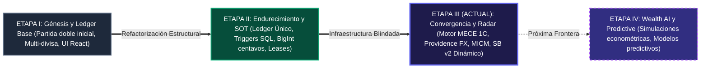
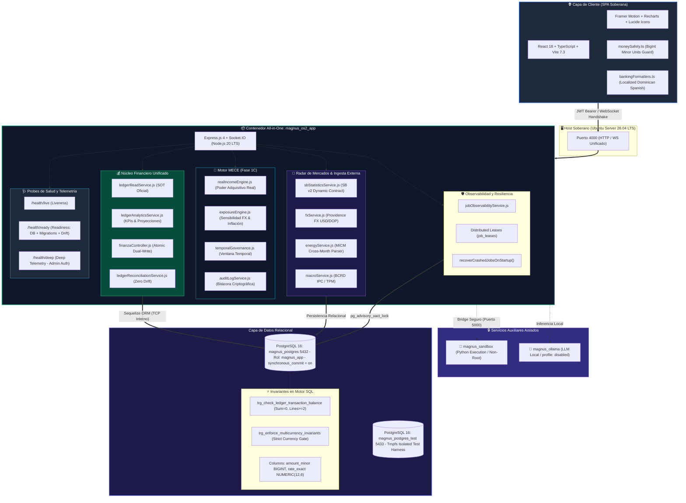
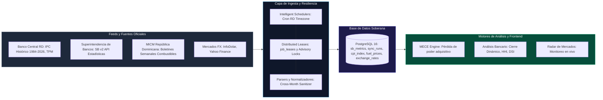
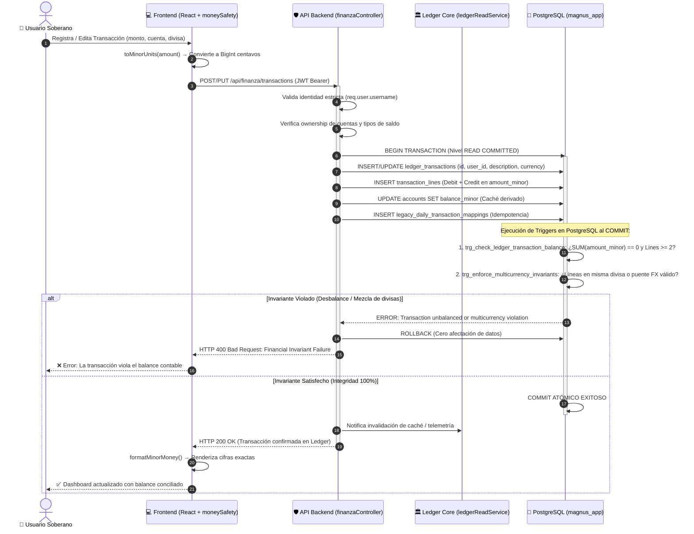
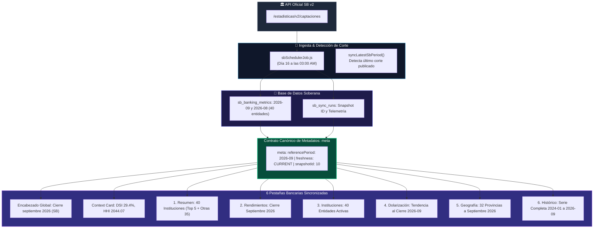

<div align="center">
  <h1>🌌 MagnusOS2</h1>
  <p><strong>Financial Operating System — Plataforma Soberana de Gestión Financiera, Inteligencia Macroeconómica y Control Patrimonial</strong></p>

  
  
  
  
  
  
  
  <br />
  
  
  
  
  
  
  
</div>

<hr />

## 📖 Sobre el Proyecto

**MagnusOS2** es un **Financial Operating System** personal de grado institucional y uso privado: un entorno operativo web full-stack diseñado para el control soberano de finanzas, administración de patrimonio e inteligencia de mercado macroeconómico.

El sistema opera bajo un principio inquebrantable: **el Ledger contable de doble entrada es la única fuente oficial de verdad financiera (Single Source of Truth - SOT)**. Toda cifra proyectada, balance de cuenta o métrica patrimonial se calcula o reconcilia matemáticamente contra el libro mayor, con integridad garantizada a nivel relacional en PostgreSQL y almacenamiento monetario exacto en unidades enteras menores (`BigInt` / centavos).

> 🏛️ **Filosofía Soberana:** El dato nunca abandona la infraestructura propia. Todo reside en la red soberana privada (**Providence Local Network**), con durabilidad transaccional estricta, aislamiento hermético de servicios y sin telemetría de terceros.
>
> 🛡️ **Clasificación de Seguridad & Resiliencia:** `[PRODUCCIÓN / HARDENED / PHASE II VALIDATED / DYNAMIC SB CANONICAL]`  
> 📑 **Informe de Auditoría Dinámica SB:** [`docs/audits/BANKING_DYNAMIC_PERIOD_AUDIT.md`](docs/audits/BANKING_DYNAMIC_PERIOD_AUDIT.md)  
> 📑 **Informe Final de Remediación (Fase II):** [`docs/audit/PHASE2_FINAL_REMEDIATION_REPORT.md`](docs/audit/PHASE2_FINAL_REMEDIATION_REPORT.md)  
> 🗺️ **Mapa de Fuente de Verdad Financiera:** [`docs/PHASE2_FINAL_SOURCE_OF_TRUTH_MAP.md`](docs/PHASE2_FINAL_SOURCE_OF_TRUTH_MAP.md)  
> 📘 **Manual de Despliegue en Producción:** [`docs/PHASE2_FINAL_PRODUCTION_RUNBOOK.md`](docs/PHASE2_FINAL_PRODUCTION_RUNBOOK.md)  
> 📂 **Archivo de Auditorías & Revisiones:** [`docs/audit/`](docs/audit/) y [`docs/audits/`](docs/audits/)

---

## 🗺️ Línea de Evolución del Sistema por Etapas (Roadmap & Milestones)

MagnusOS2 se ha consolidado a través de etapas de madurez ingenieril sucesivas, transformándose de un gestor de finanzas personales a un sistema operativo financiero con radar macroeconómico institucional:



### Síntesis de las Etapas del Sistema

* **Etapa I — Génesis y Ledger Base:** Establecimiento del esquema de partida doble, catálogo de cuentas maestras y panel de control web personal.
* **Etapa II — Endurecimiento Institucional y Reconciliación (Hardening & Remediation):** Etapa de consolidación arquitectónica en la que se eliminó la fragmentación legacy, se activaron triggers atómicos en PostgreSQL, se adoptó el estándar monetario `BigInt` (centavos), se implementaron leases distribuidos contra caídas y se verificó la salud operativa mediante simulacros de desastre (`RESTORE_DRILL`).
* **Etapa III — Convergencia Macroeconómica, Inteligencia de Mercados y Dinamismo SB (Etapa Activa):**
  * **MECE (Fase 1C):** Motor econométrico que coteja la microeconomía del usuario con la inflación real (IPC BCRD 1984–2026), sensibilidad FX y bitácora criptográfica encadenada (Merkle Tree).
  * **Providence FX & Energía:** Monitor inteligente de divisas (USD/EUR) y parser de boletines oficiales de combustibles del MICM con soporte nativo para semanas que cruzan meses.
  * **Análisis Bancario Dinámico (SB v2):** Eliminación total de datos fijos/hardcodes; gobernanza temporal basada en el último corte oficial real con contrato de metadatos estricto (`meta`).
  * **Identidad Magnus Financial Systems:** Rediseño corporativo de la landing pública y reorganización del sidebar contextual en 5 cuadrantes operativos.
* **Etapa IV — Wealth AI & Modelado Predictivo (Próxima Frontera):** Simulación avanzada de escenarios de liquidez, proyecciones multivariables y toma de decisiones patrimoniales asistida por IA local soberana.

---

## 🏛️ Topología de Infraestructura y Red Soberana

MagnusOS2 opera mediante una arquitectura multicapa contenerizada en Docker Compose, diseñada para alta disponibilidad, observabilidad y mínimo consumo de recursos:



---

## 🏛️ Arquitectura por Capas del Sistema (Clean & Modular Architecture)

La arquitectura de software de MagnusOS2 sigue principios de arquitectura limpia, asegurando que las reglas contables e invariantes nucleares sean independientes de frameworks, bases de datos o clientes web:

```mermaid
flowchart TD
    subgraph L1 ["Capas Externas: Interfaces & Presentación"]
        WebUI["💻 React SPA (TypeScript + Framer Motion)"]
        CLI["🛠️ CLI Scripts (migrate, reconcile, restore-drill)"]
        WSClient["⚡ Clientes WebSocket (Alertas en Tiempo Real)"]
    end

    subgraph L2 ["Capa de Transporte & Controladores"]
        ExpressRouter["🛡️ Express REST Endpoints (JWT / Rate Limit)"]
        SocketIO["🔌 Socket.IO Gateway (Auth Guard)"]
        HealthProbes["🩺 Health Endpoints (/live, /ready, /deep)"]
    end

    subgraph L3 ["Capa de Servicios de Dominio & Motores"]
        MECE_Motor["🌌 Motor MECE (Inflación, Erosión, Sensibilidad)"]
        SB_Motor["🏛️ Motor Bancario SB (Contrato Canónico, HHI, DSI)"]
        FX_Motor["💱 Motor Providence FX (Volatilidad & Devaluación)"]
        Energy_Motor["⛽ Motor Energía RD (MICM Cross-Month Parsing)"]
        Ledger_Service["📊 Ledger Analytics Service (SOT de Saldos)"]
    end

    subgraph L4 ["Capa de Integración, Adaptadores & Tareas"]
        Adapters["🔌 Adaptadores de Datos (BCRD, SB v2, MICM, InfoDolar)"]
        SchedulerJobs["⏰ Schedulers Inteligentes (Monitoreados c/ Leases)"]
        Recovery["🔄 Recover Crashed Jobs on Startup"]
    end

    subgraph L5 ["Núcleo Inviolable: Invariantes & Almacenamiento"]
        PG_Engine[("🐘 PostgreSQL 16 (synchronous_commit = on)")]
        SQL_Triggers["⚡ Triggers Atómicos: trg_check_balance & trg_multicurrency"]
        BigInt_Storage["🔢 amount_minor BIGINT (Cero errores de punto flotante)"]
    end

    L1 --> L2
    L2 --> L3
    L3 --> L4
    L3 --> L5
    L4 --> L5

    style L5 fill:#064e3b,stroke:#34d399,stroke-width:2px,color:#fff
    style L3 fill:#1e1b4b,stroke:#6366f1,stroke-width:2px,color:#fff
    style L2 fill:#0f172a,stroke:#38bdf8,stroke-width:2px,color:#fff
    style L1 fill:#1e293b,stroke:#3b82f6,stroke-width:2px,color:#fff
    style L4 fill:#312e81,stroke:#a855f7,stroke-width:2px,color:#fff
```



---

## 📡 Ecosistema de Datos y Radar de Inteligencia Macroeconómica

MagnusOS2 no opera en el vacío: absorbe, normaliza y audita feeds oficiales de la economía dominicana e internacional para proporcionar contexto a las finanzas privadas:



---

## 💰 Núcleo Financiero — Ciclo de Vida del Ledger de Doble Entrada

El Ledger de doble entrada es inmutable. Cada transacción financiera (ingreso, gasto, transferencia, ajuste) se procesa de forma atómica y debe cumplir estrictamente la regla matemática de suma cero por divisa:



### Invariantes Contables Garantizados en PostgreSQL

1. **Suma Cero Estricta:**
   ```sql
   -- Evaluado por trg_check_ledger_transaction_balance en COMMIT:
   SUM(transaction_lines.amount_minor) WHERE transaction_id = X = 0 AND COUNT(*) >= 2;
   ```
2. **Invariante Multimoneda:**
   ```sql
   -- Evaluado por trg_enforce_multicurrency_invariants:
   -- Todas las líneas deben compartir la divisa del encabezado, salvo operaciones con puente FX explícito.
   ```
3. **Almacenamiento Monetario Exacto:**
   - **Montos:** `amount_minor BIGINT` (centavos, sin imprecisión IEEE 754 de punto flotante).
   - **Tipos de Cambio:** `rate_exact NUMERIC(12, 6)` (precisión cambiaria institucional a 6 decimales).

---

## 🛡️ Etapa Fase II (Consolidada): Endurecimiento Institucional y Reconciliación

La **Fase II** representó la maduración estructural del sistema, eliminando cualquier vestigio de divergencia contable, asegurando cero schema drift y certificando la resiliencia operativa del entorno productivo:

| Dimensión Arquitectónica | Estado Previo (Fase I) | Estado Consolidado (Fase II) | Garantía y Evidencia Técnica |
|---|:---:|:---:|---|
| **Fuente de Verdad (SOT)** | ⚠️ Dual / Fragmentada | 🟢 **Ledger Único Oficial** | Todos los consumidores financieros consultan exclusivamente `ledgerReadService.js` / `ledgerAnalyticsService.js`. |
| **Invariante Multimoneda** | 🔴 Inexistente | 🟢 **Triggers Activos** | Triggers relacionales impiden mezclar divisas en una transacción sin puente FX explícito. |
| **Precisión Numérica** | ⚠️ Floats en UI/API | 🟢 **Exact Money (BigInt)** | Unidades menores enteras (`amount_minor`) en BD, API y componentes React (`moneySafety.ts`). |
| **Dual-Write Legacy** | 🔴 Divergente | 🟢 **Atómico (SQL Tx)** | Transacciones legacy actualizan cabecera, líneas contables y saldo de cuenta en la misma transacción SQL. |
| **Cutover de Transacciones** | ⚠️ Datos dispersos | 🟢 **433/433 Migradas (100%)** | Cutover determinista completado sin pérdida de registros ni discrepancias. |
| **Gobernanza de Schema** | ⚠️ Drift Potencial | 🟢 **Zero Drift (`isSynced`)** | 11 migraciones reproducibles (000–010) protegidas por `pg_advisory_xact_lock`. |
| **Observabilidad de Jobs** | 🔴 Inexistente | 🟢 **Leases + Telemetría** | Leases distribuidos (`job_leases`), logging estructurado y recuperación automática ante cortes de energía. |
| **Probes Operativos** | 🔴 Acoplados a JWT | 🟢 **Desacoplados** | `/health/live` y `/health/ready` públicos para orquestadores; `/health/deep` protegido para telemetría admin. |
| **Simulacro de Restore** | 🔴 No probado | 🟢 **Verificado (Drill OK)** | `npm run db:restore:drill` valida backup físico y consistencia relacional periódica. |

---

## 🌌 Etapa Fase III (Actual): Motores Especializados y Actualizaciones Recientes

### 1. Motor MECE — Macro-Economic Convergence Engine (Fase 1C)

**MECE** fusiona la microeconomía personal registrada en el Ledger con las fuerzas macroeconómicas reales de la República Dominicana:

* **Serie Histórica Oficial IPC BCRD (1984–2026):** Ingesta mensual con verificación de integridad criptográfica y gobernanza temporal.
* **Cálculo de Ingreso Real y Erosión:** Descompone la variación nominal del patrimonio frente a la inflación acumulada, calculando el poder adquisitivo neto real y tasa real de retorno simple.
* **Exposición Cambiaria y Energética:** Análisis de sensibilidad que estima el impacto directo de variaciones en la tasa USD/DOP y la canasta de combustibles en el flujo operativo del usuario.
* **Bitácora Criptográfica (Merkle Chain):** Cada consulta analítica genera un bloque con hash encadenado (`previous_hash`, `payload_hash`, `tamper_detection`), garantizando trazabilidad absoluta e inmutabilidad de los diagnósticos.
* **Defensa E2E:** 9 pruebas de seguridad que validan control de acceso basado en roles, aislamiento anti-IDOR y partición de caché.

---

### 2. Análisis Bancario Dinámico — Superintendencia de Bancos (SB v2)

La sección **Análisis Bancario** ha sido actualizada para operar bajo un contrato canónico de metadatos temporales de alta fidelidad, erradicando cualquier texto, mes o fallback numérico estático:



#### Garantías del Contrato Temporal SB

1. **Cero Hardcodes y Cero Fallbacks Ocultos:** Eliminadas las cadenas estáticas `"Cierre Agosto 2026"` y los valores sustitutos (`29.7%`, `1.76%`, `4.09%`, `40 instituciones`). Si un dato no está disponible, el sistema declara explícitamente `Dato no disponible` en lugar de inventar números.
2. **Conteo Dinámico de Entidades:** El total de instituciones (`data.institutionCount = 40`) y la agrupación de mercado (`Otras (35)`) se derivan del conteo real de entidades válidas presentes en el corte.
3. **Formateador Centralizado en Español Dominicano:** `bankingFormatters.ts` genera etiquetas institucionales limpias (`Cierre septiembre 2026`, `Último corte oficial disponible: septiembre 2026`) con validación defensiva `Number.isNaN`.
4. **Sincronización Total entre Pestañas:** El encabezado global, las tarjetas de contexto y las 6 pestañas funcionales (Resumen, Rendimientos, Instituciones, Dolarización, Geografía e Histórico) consumen el mismo período de referencia sin divergencia.

---

### 3. Radar Energético & Providence FX

* **Parser de Combustibles MICM Multi-Mes:** Capacidad de interpretar avisos de precios semanales que cruzan meses (p.ej. `31-OCT a 06-NOV`), normalización fonética de nombres de combustibles, extracción de subsidios oficiales por galón y deduplicación estricta por `(fuel_id, valid_from)`.
* **Providence FX:** Monitoreo y analítica de volatilidad cambiaria USD/DOP y EUR/DOP con tasas del BCRD, análisis de spread y cobertura frente a devaluación.

---

### 4. Magnus Financial Systems & Sidebar Modular

* **Landing Corporativa:** Rediseño completo de la página institucional de bienvenida con temática financiera dorada, tipografía monospace y copy institucional soberano.
* **Navegación Contextual Reorganizada:**
  * **Radar de Mercados:** Monitoreo en vivo de divisas, energía y contexto macro.
  * **Análisis Bancario:** Acceso directo a las 6 pestañas de estadísticas SB.
  * **Planificación Patrimonial:** Flujo de caja, proyecciones, simulación Monte Carlo y convergencia MECE.
  * **Laboratorio Financiero:** Simuladores econométricos y mentoría.
  * **Torre de Control:** Panel administrativo, estado de contenedores y salud del sistema.

---

## 🚀 Puesta en Marcha y Verificación

### Prerrequisitos

* [Ubuntu Server](https://ubuntu.com/) v26.04 LTS o superior
* [Docker](https://www.docker.com/) v29.1+ & Docker Compose v2.40+
* [Node.js](https://nodejs.org/) v20 LTS (v20.20+)
* [PostgreSQL Client](https://www.postgresql.org/) v16 (`pg_dump` / `pg_restore`)

### Ejecución de Pruebas (100% Aisladas)

MagnusOS2 cuenta con un arnés de pruebas estricto que **nunca toca la base de datos de producción**:

```bash
# 1. Ejecutar la suite completa de pruebas unitarias y de integración (91 pruebas)
npm test

# 2. Ejecutar chequeo de tipos estricto con TypeScript
npx tsc --noEmit

# 3. Compilar frontend de producción con Vite
npm run build

# 4. Validar estado de gobernanza de migraciones relacionales
docker compose run --rm --no-deps magnus node scripts/migrate.js status

# 5. Ejecutar simulacro completo de respaldo y restauración en sandbox
npm run db:restore:drill
```

### Comprobación de Salud en Producción (Live Probes)

```bash
# Liveness Probe (¿El servidor Express responde?)
curl -s http://127.0.0.1:4000/api/health
# {"status":"UP","timestamp":"2026-11-01T...","uptimeSeconds":45,"version":"2.0.0"}

# Resumen Bancario con Metadatos Canónicos (Verifica corte dinámico y frescura)
curl -s http://127.0.0.1:4000/api/markets/banking/summary | jq .meta
# {
#   "source": "SB v2 API",
#   "referencePeriod": "2026-09",
#   "freshness": "CURRENT",
#   "snapshotId": 10
# }

# Reconciliación Contable en Vivo
docker compose run --rm --no-deps magnus node scripts/reconcile-ledger.js
# Status: HEALTHY | Discrepancies: 0 | Security Leaks: 0
```

---

## 📂 Estructura Detallada del Repositorio

```
MagnusOS2/
├── server/                         # Backend Institucional Node.js 20 LTS
│   ├── adapters/                   # Adaptadores de integración y desacoplamiento
│   │   └── mece/                   # Adaptadores MECE (Ledger, Macro, FX, Energy)
│   ├── config/database.js          # Configuración de conexiones PostgreSQL / SQLite
│   ├── controllers/                # Controladores de dominio (finanzas, mece, sb, mercado)
│   │   ├── sbBankingController.js  # Endpoints bancarios con contrato temporal canónico
│   │   ├── meceController.js       # Controlador del motor de convergencia MECE
│   │   └── finanzaController.js    # Controlador de transacciones y libro mayor
│   ├── data/                       # Staging offline e histórico verificado (CPI BCRD, etc.)
│   ├── jobs/                       # Schedulers inteligentes (SB, FX, Macro, Energía)
│   ├── middleware/                 # JWT estricto, rate limiting, security headers Helmet
│   ├── migrations/                 # Migraciones relacionales ordenadas (000_ a 015_)
│   ├── models/                     # Modelos Sequelize 6 (Ledger, Cuentas, Mercados, Jobs)
│   ├── routes/                     # Rutas modulares REST (finanza, auth, mece, sb, energy)
│   ├── services/                   # SOT Financiero, Observabilidad, Gobernanza y Reconciliador
│   │   ├── ledgerReadService.js    # Lógica oficial de consulta del libro mayor
│   │   ├── ledgerAnalyticsService.js # Agregación contable y métricas sin mezcla de divisas
│   │   ├── mece/                   # Motores MECE (realIncome, exposure, temporal, auditLog)
│   │   ├── sb/                     # Servicios SB (sbStatisticsService, sbMetrics)
│   │   ├── jobObservabilityService.js# Leases distribuidos y ciclo de vida de jobs
│   │   ├── migrationRunner.js      # Ejecutor transaccional con advisory locks
│   │   └── schemaDriftService.js   # Verificador de paridad Sequelize vs PostgreSQL
│   └── socket/                     # Handlers WebSocket autenticados en tiempo real
├── src/                            # Frontend React 18 + TypeScript + Vite
│   ├── apps/
│   │   ├── finanza/                # Módulo Financiero (Ledger, CashFlow, Providence FX)
│   │   │   ├── components/
│   │   │   │   ├── banking/        # Componentes y pestañas de Análisis Bancario (SB v2)
│   │   │   │   │   ├── BankingSection.tsx     # Sección principal con badge de corte dinámico
│   │   │   │   │   ├── BankingContextCard.tsx # Tarjetas de contexto sin fallbacks fijos
│   │   │   │   │   └── tabs/                  # 6 Pestañas sincronizadas (Resumen, Rendimientos...)
│   │   │   │   ├── ConvergenceTab.tsx         # Pestaña del motor MECE
│   │   │   │   └── macro/                     # Macro RD y visualización de indicadores
│   │   │   ├── pages/              # Páginas principales (Ledger, Cuentas, Banca, Mercados)
│   │   │   └── utils/
│   │   │       ├── bankingFormatters.ts       # Formateo localizado en español dominicano
│   │   │       └── moneySafety.ts             # Blindaje numérico BigInt contra errores de redondeo
│   │   ├── landing/                # Magnus Financial Systems — Landing institucional y legal
│   │   ├── magnus/                 # Sabiduría, Pensum, Lab IA y Centro de Comando
│   │   └── server-admin/           # Torre de Control Soberana (HUD, Hardware, Logs)
│   └── shared/                     # Componentes y contextos compartidos
├── tests/                          # Suite de pruebas automatizadas (91 tests passing)
│   ├── sbDynamicPeriod.test.js     # Pruebas de contrato dinámico y no-hardcodes SB
│   ├── sbMetrics.test.js           # Pruebas de frescura y cálculo de métricas SB
│   ├── meceExpressSecurityE2E.test.js # Pruebas E2E de seguridad MECE
│   ├── energyProvider.test.js      # Pruebas del parser de combustibles MICM
│   └── moneySafety.test.js         # Pruebas de integridad numérica BigInt
├── scripts/                        # Automatizaciones de infraestructura
│   ├── cutover-daily-transactions.js # Migrador idempotente de transacciones legacy
│   ├── reconcile-ledger.js         # Auditor de integridad de saldos en tiempo real
│   ├── migrate.js                  # CLI de migraciones y baselines
│   └── restore-drill.js            # Simulacro de restauración de backups en sandbox
├── docs/                           # Documentación de ingeniería, guías y gobernanza
│   ├── DOCS.md                     # Documentación técnica integral histórica
│   ├── GUIA_COMANDOS.md            # Guía operativa de comandos y túneles seguros
│   ├── audits/                     # Auditorías técnicas dinámicas (SB v2, etc.)
│   │   └── BANKING_DYNAMIC_PERIOD_AUDIT.md # Auditoría de períodos dinámicos SB v2
│   ├── audit/                      # Informes de auditoría y certificación (Fase II, Stress Test)
│   │   ├── PHASE2_FINAL_REMEDIATION_REPORT.md # Informe de remediación y hardening
│   │   └── INFORME_STRESS_TEST_2026-10-24.md  # Resultados de stress test de concurrencia
│   ├── FX_SERVICE.md               # Especificación del servicio Providence FX
│   ├── ENERGY_RD.md                # Monitor de combustibles y mercado energético MICM
│   ├── MACRO_RD.md                 # Contexto macroeconómico y series del BCRD
│   ├── PHASE2_FINAL_SOURCE_OF_TRUTH_MAP.md # Matriz de fuentes de verdad
│   └── PHASE2_FINAL_PRODUCTION_RUNBOOK.md  # Runbook paso a paso para despliegues
├── docker-compose.yml              # Orquestación de servicios en red soberana
├── Dockerfile.api                  # Imagen multicapa optimizada para producción
└── package.json                    # Dependencias y scripts de prueba
```

---

## 🔒 Seguridad y Principio de Menor Privilegio

* **Identidad Inmutable:** La identidad del usuario se deriva estrictamente del payload criptográfico del token JWT verificado en backend (`req.user.username` / `socket.user.username`). No se aceptan parámetros de suplantación en `body`, `query` o `params`.
* **Menor Privilegio en Base de Datos:** La aplicación se conecta mediante el usuario dedicado `magnus_app` (`NOSUPERUSER`, `NOCREATEDB`, `NOCREATEROLE`, `NOBYPASSRLS`), garantizando que una vulnerabilidad a nivel de aplicación no comprometa el motor de PostgreSQL.
* **Durabilidad Máxima:** `synchronous_commit = on` activado permanentemente en PostgreSQL para garantizar que toda transacción confirmada esté escrita en disco ante cualquier corte abrupto de energía.
* **Python Sandbox Enjaulado:** Contenedor no-root (`sandboxuser`, UID 1000) con límites de CPU (1.0), memoria (512MB), archivos temporales únicos con UUID y timeout forzoso de 20s.

---

## ✒️ Autor y Créditos

Este Financial Operating System fue conceptualizado, diseñado y desarrollado por:

* **YoxeLaunch** — Creador Original, Arquitecto de Software y Desarrollador Principal  
* GitHub: [@YoxeLaunch](https://github.com/YoxeLaunch)

<br />
<div align="center">
  <p><strong>Construido para la Soberanía Financiera y el Control Total ⚜️ — Diseñado por YoxeLaunch</strong></p>
  <sub>© 2026 MagnusOS2 Project · Self-hosted · Sovereign by design</sub>
</div>
