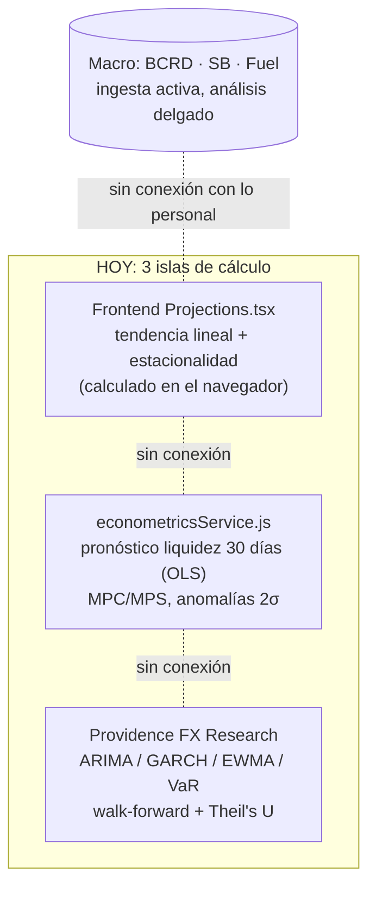
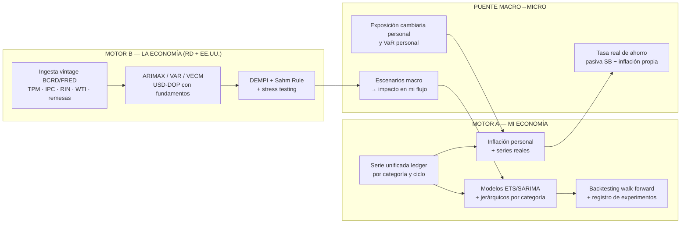

# PROVIDENCE ECON — Análisis y Proyección de la Economía (Macro) y Mi Economía (Micro)
**Ecosistema:** Providence / Magnus OS2
**Alcance del documento:** Diagnóstico del estado actual del módulo financiero y del motor Providence FX, brecha entre *captura de datos* y *análisis/proyección*, y plan de tecnologías, fórmulas y backlog para convertir el apartado "Proyección 2026" en un verdadero sistema de análisis y proyección económica.
**Fecha:** 2026-10-25
**Datos verificados en producción:** `magnus_postgres` (lecturas directas), código `server/` y `src/apps/finanza/`.

---

## 1. DIAGNÓSTICO — QUÉ EXISTE HOY (VERIFICADO)

### 1.1 Activos de datos reales (producción, 2026-10-25)

| Fuente | Volumen | Rango | Estado |
| --- | ---: | --- | --- |
| `DailyTransactions` (seguimiento diario) | 442 mov. | 2025-12-12 → 2026-10-23 | **Activo, espejado al ledger** (partida doble con trigger de balance) |
| `Transactions` (conceptos recurrentes "presupuesto") | 21 conceptos | 2025-12-24 → 2026-04-01 | Activo, versionado temporal (`validFrom/validTo`) |
| `fx_rate_observations` (Providence FX) | 27,202 obs. | 1991-01-02 → 2026-10-25 | **El activo más rico del sistema** |
| `fuel_price_observations` | 6,821 | — | Ingesta semanal activa |
| `sb_banking_metrics` (Superintendencia de Bancos) | 19,513 | — | Ingesta v2 activa |
| `macro_observations` / `macro_indicators` | 31 / 11 | — | Catálogo definido (IPC, TPM, RIN, IMAE, tasas…), **serie histórica casi vacía** |
| `WealthSnapshots` (patrimonio) | **2** | 2026-01-26 → 2026-01-27 | **Crítico: sin serie temporal de patrimonio** |
| `monthly_snapshots` (análisis mensual + Gemini) | **2** | — | Subutilizado |
| `savings_goals` / `financial_anomalies` | 0 / 0 | — | Motor existe, sin uso |

Economía personal registrada (usuario `soberano`, ~10.5 meses): ingresos ≈ RD$ 669,200, gastos ≈ RD$ 393,200 (Deudas, Transporte y Compras dominan), inversiones ≈ RD$ 133,300. Disciplina de registro: ~1.4 movimientos/día. Calidad de datos buena (descripciones, categorías, montos exactos en centavos).

### 1.2 Tres motores de proyección que NO se hablan entre sí

1. **Proyección 2026 (frontend):** `src/apps/finanza/pages/Projections.tsx` calcula en el cliente, alimentado **exclusivamente** por seguimiento diario: modelo escalonado (promedio → regresión lineal → tendencia × factores estacionales), 12 ciclos proyectados, Monte Carlo en web worker (p10/p50/p90), FIRE, Sankey, heatmap, cohortes. Es el apartado más avanzado, pero: sus parámetros no se persisten ni se auditan, **no tiene backtesting con cero fuga de información**, sus baselines de arranque frío (ingreso 4,500 / gasto 2,800) y la "meta 20%" de ahorro están hardcodeadas.
2. **Econometría personal (backend):** `server/services/econometricsService.js` — OLS, MPC/MPS, pronóstico de liquidez a 30 días con bandas 95%, detección de anomalías por categoría (motor sano; **0 anomalías registradas**, umbrales sin afinar).
3. **Providence FX (backend):** motor cuantitativo Nivel 3.1 maduro — 6 modelos (Random Walk, RW-drift, SMA, SES, ARIMA(1,1,0), GARCH(1,1)), backtesting walk-forward con métricas MAE/RMSE/MAPE/Theil's U/pinball, VaR paramétrico e histórico, validación empírica de Meese-Rogoff, gobernanza con zero-lookahead. **Es el patrón arquitectónico que debe replicarse en la economía personal.**

### 1.3 Deudas y stubs detectados

- **No existe entidad Budget**: el "presupuesto" del gráfico *Presupuesto vs Realidad* es simplemente el equivalente mensual de los gastos recurrentes (`BudgetVsRealityChart.tsx`); no hay CRUD de presupuesto ni comparación por categoría planificado-vs-real.
- `GET /api/ledger/investments?groupBy=cycle` (CronologiaHeader) **no tiene ruta backend** → 404 silencioso.
- Tarjeta de categoría principal en `CashFlow.tsx` hardcodeada ("Transporte / 6,000").
- `categoriesApi.getAll` devuelve `[]` (TODO); `Dashboard.tsx` (versión enriquecida) no está ruteada; `Investments.tsx` huérfano.
- `WealthSnapshots` sin cron automático → imposible analizar evolución patrimonial con 2 registros.
- Sin librería matemática alguna: todo el cálculo (OLS, GARCH, ADF, VaR, CDF normal) es implementación manual en JS — impecable para univariado, insuficiente para multivariado (VAR/VECM/Johansen del roadmap).

### 1.4 La brecha central

> **MagnusOS2 es hoy un excelente sistema de CAPTURA (seguimiento, ledger) y de MONITOREO (FX, banca, combustibles, macro), pero un sistema delgado de ANÁLISIS y PROYECCIÓN.** Los datos personales no se deflactan por inflación, no miden exposición cambiaria, no reciben choques macro en sus escenarios, y las proyecciones personales no se auditan contra lo que realmente ocurrió. Además, los 3 motores de cálculo están duplicados y fragmentados entre frontend y backend.

---

## 2. VISIÓN PROPUESTA — "PROVIDENCE ECON"

Extender la disciplina cuantitativa de Providence FX (zero-lookahead, experimentos auditables, benchmark contra naive) del tipo de cambio **a la economía completa**: un motor gemelo con puente macro→micro.

**Principio rector:** todo modelo personal hereda la gobernanza ya institucionalizada en Providence FX: *zero lookahead*, dataset con hash SHA-256, experimentos persistidos, benchmark obligatorio contra naive estacional, etiqueta "Estimación Experimental" y aprobación humana para cambios de modelo.

---

## 3. BACKLOG PRIORIZADO

### Fase 0 — Cimientos de datos (quick wins, 1–2 semanas)

| # | Acción | Por qué |
| --- | --- | --- |
| 0.1 | **Cron de `WealthSnapshots`** (mensual desde ledger: `getNetWorth` → insert) | Sin serie patrimonial no existe "análisis de mi economía"; hoy solo hay 2 registros |
| 0.2 | **Entidad `Budget` real** (tabla + CRUD + comparación plan-vs-real por categoría y ciclo, alimentando `BudgetVsRealityChart`) | El presupuesto actual es un subproducto de gastos recurrentes; el análisis requiere presupuesto explícito |
| 0.3 | **Reparar stubs**: ruta `/api/ledger/investments`, tarjeta hardcodeada de CashFlow, `categoriesApi`, decidir destino de `Dashboard.tsx` huérfano | Limpieza previa a construir encima |
| 0.4 | **Activar el bucle de anomalías** (afinar umbrales 2σ, revisar semanalmente, justificar vía UI/Telegram) | El servicio existe y tiene 0 registros; es analítica gratis ya construida |
| 0.5 | **Disciplina de registro** (racha diaria, recordatorio Telegram/n8n a las 21:00) | Con 12+ ciclos completos se habilita estacionalidad anual confiable |

### Fase 1 — Motor A: análisis y proyección de MI economía (2–4 semanas)

| # | Acción | Detalle técnico |
| --- | --- | --- |
| 1.1 | **Serie unificada backend** (`ledgerAnalyticsService` ya es la fuente de verdad): materializar agregados diarios/mensuales por categoría | Vistas materializadas PG con refresco por cron (o TimescaleDB continuous aggregates, §4.2) |
| 1.2 | **Migrar el motor de proyección del frontend al backend** como `econResearchService` replicando el patrón de `fx/research/`: `experiments` + `forecasts` persistidos, hash de dataset, walk-forward | Elimina duplicación frontend/backend; toda proyección queda auditable |
| 1.3 | **Modelos**: ETS/Holt-Winters (nivel+tendencia+estacionalidad), SARIMA mensual, naive estacional como benchmark, proyección jerárquica por categoría (bottom-up + reconciliación) | Ver fórmulas §5; con 10–12 ciclos, ETS aditivo > ML |
| 1.4 | **Bandas de incertidumbre honestas**: cuantiles out-of-sample + *conformal prediction* (reutilizar el pinball loss ya implementado en `backtestEngine.js`) | Cobertura garantizada sin supuestos de normalidad (§4.4) |
| 1.5 | **Backtesting personal con Theil's U** contra naive estacional; regla de promoción igual que FX (U < 1 para superar al benchmark) | Honestidad: en horizontes largos el naive es duro rival (Meese-Rogoff también aplica a households) |
| 1.6 | **Inflación personal (la joya)**: π_personal = Σ wᵢ·πᵢ con pesos = gasto propio por categoría y πᵢ = variación IPC de esa división (BCRD/ONE) → deflactar ingresos/gastos a pesos reales, ahorro real | Conecta directamente Motor A con macro; ya existe `macro_indicators` para nutrirlo |
| 1.7 | **Descomposición precio-volumen**: Δgasto = efecto inflación propia + efecto volumen real por categoría | Convierte "gasté más" en "¿pagué más caro o consumí más?" |

### Fase 2 — Puente Macro→Micro (2–3 semanas)

| # | Acción | Detalle técnico |
| --- | --- | --- |
| 2.1 | **Exposición cambiaria personal**: % de ingresos/gastos/activos/pasivos en USD vs DOP; Tipo de Cambio Efectivo Personal; VaR cambiario del patrimonio usando la volatilidad GARCH(1,1) ya estimada de USD/DOP | Reutiliza directamente `getRiskAnalytics` de Providence FX |
| 2.2 | **Tasa real de ahorro**: tasa pasiva promedio (SB, ya ingerida) − inflación personal → alerta "¿dolarizar o certificado en DOP?" | Conecta `BankingPage` con decisiones personales |
| 2.3 | **Escenarios macro con datos reales en `ScenarioSimulator`**: reemplazar sliders manuales por escenarios del roadmap FX (Fed +100bps, WTI $105, caída turismo 20%) propagados vía elasticidades estimadas de las categorías propias (ej. transporte vs WTI) | El roadmap 3.4 ya define los escenarios; faltaba el receptor personal |
| 2.4 | **Índices de alerta temprana**: DEMPI (roadmap ETAPA V) + Regla de Sahm EE.UU. vía FRED (canal remesas/turismo hacia RD) | Ver §5.3 |

### Fase 3 — Motor B: proyección macro (alinear con roadmap FX 3.2–3.5)

| # | Acción | Detalle técnico |
| --- | --- | --- |
| 3.1 | **Ingesta vintage macro** (TPM, IPC, RIN, WTI, remesas, turismo) con `reference_period` + `release_timestamp` | Ya diseñado en `PROVIDENCE_FX_LEVEL3_ROADMAP.md` ETAPA I; reutilizar para inflación personal (1.6) |
| 3.2 | **ARIMAX → VAR/VECM** USD/DOP con fundamentos; prueba de Johansen; velocidad de ajuste α hacia PPP | Requiere Python sidecar (§4.1) o regresión multivariada manual en Node |
| 3.3 | **Stress testing patrimonial**: Monte Carlo con innovaciones Student-t condicionadas a GARCH (cópulas para income/expense conjuntos); migrar el worker MonteCarlo del navegador a workers backend con `nice +10` | El worker web actual ya valida el concepto; backend permite horizontes largos y datos completos |
| 3.4 | **Integración Magnus Capital VaR/CVaR + margen de reserva recomendado** | Roadmap ETAPA IV tal cual |

---

## 4. TECNOLOGÍAS INVESTIGADAS

### 4.1 Python sidecar de econometría (recomendación principal)
El roadmap FX ya prevé "subproceso aislado Python/statsmodels ≈150 MB" para Fase 3.3. Formalizarlo como **microservicio FastAPI contenedorizado** con límites de CPU/memoria y comunicación REST desde Node:
- **statsmodels**: SARIMAX, VAR, VECM, Johansen, pruebas ADF/KPSS, ARCH-LM — lo que Node no ofrece.
- **Nixtla StatsForecast**: AutoETS/AutoARIMA optimizados, **conformal prediction integrado**, pensado para producción ([docs](https://nixtlaverse.nixtla.io/statsforecast/index.html)); MLForecast para features automáticas ([docs](https://nixtlaverse.nixtla.io/mlforecast/index.html)).
- Regla de proyecto: lo univariado simple puede seguir en Node (ya funciona); lo multivariado y estacional complejo va al sidecar. Nunca exponer el sidecar públicamente.

### 4.2 TimescaleDB sobre PostgreSQL 16 (analítica temporal)
Hypertables para `fx_rate_observations`, `macro_observations` y la serie diaria del ledger, con **continuous aggregates** (vistas materializadas incrementales) para rollups diario/mensual ([TigerData docs](https://www.tigerdata.com/learn/continuous-aggregates-timescaledb), [GitHub](https://github.com/timescale/timescaledb)). Lecciones de producción en [Reddit r/PostgreSQL](https://www.reddit.com/r/PostgreSQL/comments/1somukq/timescaledb_continuous_aggregates_what_i_got_wrong). **Alternativa sin migración de imagen:** vistas materializadas nativas de PG + `REFRESH` por cron — suficiente para el volumen actual (442 movimientos + 27k FX); Timescale vale la pena cuando la ingesta macro diaria crezca.

### 4.3 FRED API (EE.UU.) y series externas
Fed Funds, CPI-U, desempleo (Sahm), WTI ya vía Yahoo. FRED es gratuita con API key y es la fuente canónica ([SAHMREALTIME](https://fred.stlouisfed.org/series/SAHMREALTIME)). Complementa a BCRD/SB que ya están ingeridos.

### 4.4 Conformal prediction para bandas de cobertura
Marco post-hoc con cobertura garantizada sin supuestos distribucionales; para series temporales se usan variantes dependientes del orden (EnbPI, SAR conformal) ([Stocker et al. 2025](https://arxiv.org/abs/2511.13608), [IEEE 2025](https://ieeexplore.ieee.org/document/10870871), [tutorial StatsForecast](https://nixtlaverse.nixtla.io/statsforecast/docs/tutorials/conformalprediction.html)). Encaja perfecto sobre los residuos walk-forward que el backtester ya produce.

### 4.5 Lo que NO hace falta
- No se necesita cambiar Recharts por ECharts ni introducir Redis/colas nuevas: el cuello es el modelo de datos y los servicios, no el rendering.
- No se recomienda TimeGPT/foundation models ni deep learning: con ~12 observaciones mensuales por categoría, los modelos estadísticos clásicos ganan y son interpretables.

---

## 5. CATÁLOGO DE FÓRMULAS

### 5.1 Microeconomía personal (Motor A)
| Fórmula | Expresión | Uso |
| --- | --- | --- |
| **Inflación personal (Laspeyres propia)** | $\pi^{p}_t = \sum_i w_{i,0}\left(\frac{P_{i,t}}{P_{i,t-1}}\right) - 1$, con $w_{i,0} = \frac{\text{gasto propio cat. } i}{\text{gasto total}}$ | Re-ponderar IPC por división (BCRD/ONE) con los pesos del propio gasto ([método](https://www.cnbc.com/2022/07/07/as-prices-rise-nationwide-how-to-calculate-your-own-inflation-rate.html), [BLS](https://www.bls.gov/cpi/questions-and-answers.htm)) |
| **Serie real** | $X^{real}_t = X^{nom}_t / \prod_{k\le t}(1+\pi^p_k)$ | Ingresos/gastos/patrimonio en pesos de poder adquisitivo constante |
| **Ahorro real** | $S^{real} = S^{nom} - \pi^p \cdot W$ | ¿Me estoy haciendo más rico de verdad? |
| **ETS / Holt-Winters aditivo** | $\hat{y}_{t+h} = \ell_t + h b_t + s_{t+h-m}$ con $\ell_t = \alpha(y_t - s_{t-m}) + (1-\alpha)(\ell_{t-1}+b_{t-1})$, etc. | Proyección mensual de gasto/ingreso con estacionalidad (reemplaza regresión lineal de `Projections.tsx`) |
| **SARIMA(p,d,q)(P,D,Q)[12]** | estándar Box-Jenkins sobre log-ingresos/gastos | Alternativa a ETS cuando hay autocorrelación residual |
| **Jerárquica + reconciliación** | bottom-up por categoría, MinT para que Σcategorías = total | Coherencia entre vista por categoría y vista agregada |
| **Benchmark naive estacional** | $\hat{y}_{t+h} = y_{t+h-m}$ | Theil's U = RMSE_model / RMSE_naive; U < 1 justifica el modelo |
| **Conformal** | $q_\alpha = \text{cuantil}_{(1-\alpha)(1+1/n)}\{|e_i|\}$ de residuos calibrados; intervalo $\hat{y} \pm q_\alpha$ | Bandas 90/95% con cobertura empírica garantizada |
| **FIRE** | capital objetivo = gasto anual real × 25 (regla del 4%) | Ya existe `FIRECalculator`; conectar a serie real (5.1 fila 2) |
| **Block bootstrap Monte Carlo** | remuestrear bloques de Δ mensuales (preserva autocorrelación), simular N=10,000 trayectorias → p10/p50/p90, prob. de déficit | Evolución del worker actual |

### 5.2 Puente Macro→Micro
| Fórmula | Expresión | Uso |
| --- | --- | --- |
| **Tipo de Cambio Efectivo Personal** | $TCEP = \frac{\text{gasto mensual en USD}}{\text{ingreso mensual total}}$ | Mide dolarización del estilo de vida |
| **VaR cambiario personal** | $VaR_{95} = 1.645 \cdot \sigma_{GARCH} \cdot \sqrt{h} \cdot E_{USD}^{neta}$ | Pérdida DOP esperada de una devaluación sobre la posición neta en USD; σ ya estimada por Providence FX |
| **Tasa real de ahorro** | $r^{real} = i^{pasiva}_{SB} - \pi^{personal}$ | ¿Gana mi ahorro en DOP frente a MI inflación? |
| **Elasticidad categoría↔macro** | $\beta$ de OLS: $\Delta\ln(gasto_i) = \alpha + \beta \Delta\ln(WTI\text{ o }IPC_i)$ | Propagar escenarios macro (WTI +30% → mi transporte +β·30%) |
| **Descomposición precio-volumen** | $\Delta gasto_i \approx \underbrace{g_{i,0}\cdot\pi^p_i}_{\text{precio}} + \underbrace{q_{i,t} - q_{i,0}}_{\text{volumen}}$ | Diagnóstico por categoría |

### 5.3 Macroeconomía (Motor B, alineado al roadmap FX)
| Fórmula | Expresión | Uso |
| --- | --- | --- |
| **DEMPI** (ya en roadmap) | $\frac{\Delta e_t}{\sigma_e} - \frac{\Delta RIN_t}{\sigma_{RIN}} + \frac{\Delta i_t}{\sigma_i}$ | Presión cambiaria disimulada por intervención del BCRD |
| **Regla de Sahm** | $S_t = \bar{U}_{3m} - \min_{12m}(U)$; recesión si $S_t \ge 0.50$ pp | Alerta temprana EE.UU. (canal remesas/turismo); fuente [FRED SAHMREALTIME](https://fred.stlouisfed.org/series/SAHMREALTIME) |
| **ARIMAX** | $\Delta P_t = c + \sum\phi_p\Delta P_{t-p} + \sum\beta_j X_{j,t-1} + \varepsilon_t$ | Roadmap ETAPA II (diferencial TPM, WTI) |
| **VECM / Johansen** | $\Delta Y_t = \Pi Y_{t-1} + \sum\Gamma_i\Delta Y_{t-i} + u_t$, $\Pi=\alpha\beta'$ | Equilibrio de largo plazo USD/DOP vs fundamentos (roadmap ETAPA II) |
| **VaR Cornish-Fisher / CVaR** | roadmap ETAPA IV | Tesorería Magnus Capital |

---

## 6. ADVERTENCIAS METODOLÓGICAS

1. **Horizonte de datos:** con ~10.5 ciclos completos, la estacionalidad anual es apenas observable. Los modelos deben declarar su confianza y degradarse a promedios honestos; el comparador estacional madura en diciembre 2026 (12 ciclos completos).
2. **Naive es un rival duro:** igual que el Enigma de Meese-Rogoff en FX, en finanzas personales el naive estacional suele igualar modelos sofisticados a 12+ meses. El valor del sistema está en **bandas, escenarios, detección temprana y deflactación real**, no en acertar el punto exacto.
3. **Zero-lookahead universal:** ninguna proyección personal puede usar información de su futuro en el backtest (incluye los factores estacionales de `Projections.tsx`, hoy calculados con todo el histórico).
4. **Human-in-the-loop:** mantener la prohibición de auto-promoción de modelos (roadmap ETAPA V); el usuario aprueba cambios de modelo y cada predicción se etiqueta "Estimación Experimental".
5. **Soberanía de recursos:** el sidecar Python y los Monte Carlo backend corren con límites estrictos (`nice +10`, mem_limit) y en ventanas de baja actividad; Providence FX LIVE y los servicios del servidor tienen prioridad absoluta.
6. **Multi-usuario:** el sistema ya soporta varios `userId` (soberano 286, reymondescano 154 movimientos); los motores deben segmentar por usuario desde el día uno.

## 7. ORDEN DE EJECUCIÓN SUGERIDO (resumen ejecutivo)

1. **Semana 1–2:** cron de patrimonio (0.1) + entidad Budget (0.2) + reparar stubs (0.3) + anomalías (0.4).
2. **Semana 3–4:** serie unificada backend (1.1) + servicio de experimentos personales (1.2) con ETS/naive/conformal (1.3–1.5).
3. **Semana 5:** inflación personal (1.6) — primera conexión real macro↔micro, alto impacto visible.
4. **Semana 6–7:** puente: exposición cambiaria + VaR personal + tasa real de ahorro (2.1–2.2) y escenarios macro en el simulador (2.3).
5. **Después:** Python sidecar + vintage macro + VAR/VECM (Fase 3, sincronizada con roadmap FX 3.2–3.3).

---
*Fuentes de investigación: [Nixtla StatsForecast](https://nixtlaverse.nixtla.io/statsforecast/index.html) · [MLForecast](https://nixtlaverse.nixtla.io/mlforecast/index.html) · [Conformal forecasting (arXiv)](https://arxiv.org/abs/2511.13608) · [TimescaleDB continuous aggregates](https://www.tigerdata.com/learn/continuous-aggregates-timescaledb) · [FRED Sahm Rule](https://fred.stlouisfed.org/series/SAHMREALTIME) · [Cálculo de inflación personal (CNBC)](https://www.cnbc.com/2022/07/07/as-prices-rise-nationwide-how-to-calculate-your-own-inflation-rate.html) · [BLS CPI FAQs](https://www.bls.gov/cpi/questions-and-answers.htm)*
